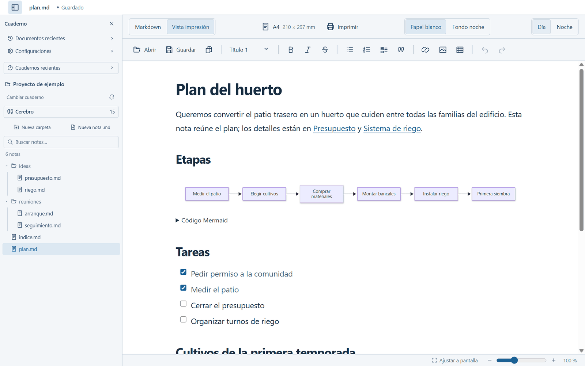
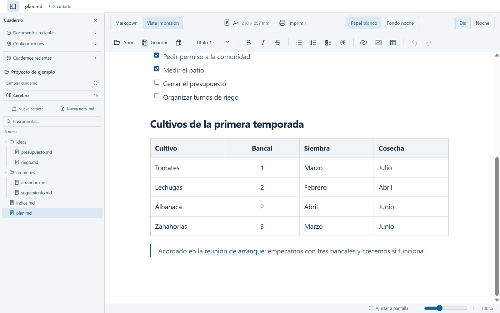
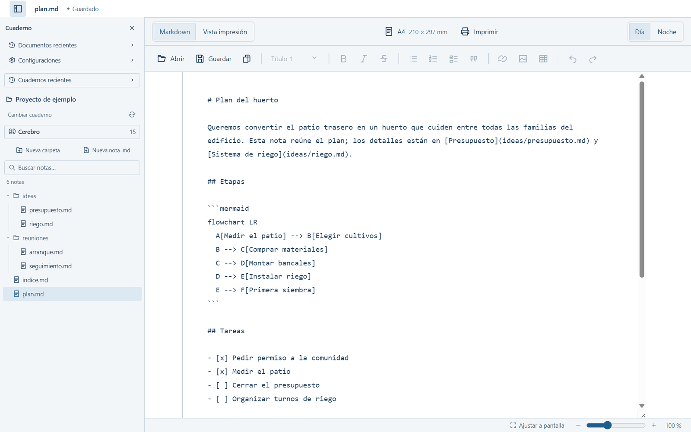
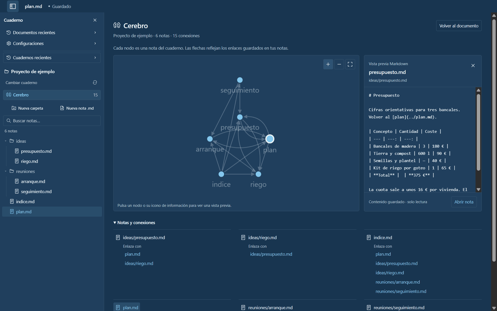
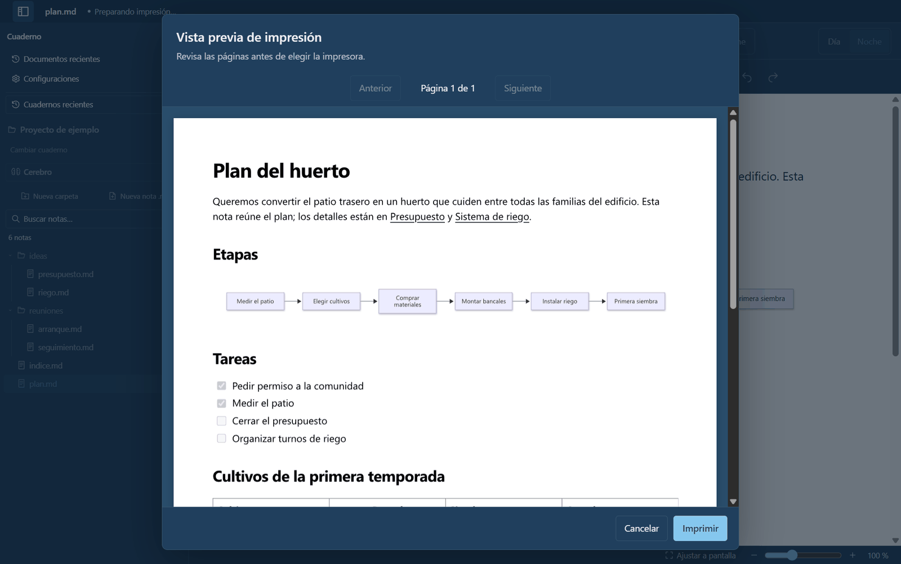

# hiloo

[Español](README.md) · English

A Markdown note editor for Windows. You write with formatting, like in a word processor, and hiloo saves plain `.md` files on your disk.

- **Local files.** Your notes are `.md` files in a folder on your PC. No account, no cloud, and any other editor can open them.
- **Connected notebooks.** A folder is a notebook. Link notes to each other and see those links as a graph.
- **Ready for AI.** An external AI tool, such as Claude or Codex, can search and read your notes through a local CLI and the `hiloo-notes` skill.

The interface is in Spanish.



> hiloo is in development. For now it runs only on 64-bit Windows and you try it from source: there is no published installer. Saving is manual; there is no autosave or version history yet.

## What you can do

- **Notebooks:** a sidebar with notes and subfolders, recent notebooks and documents, and an optional `indice.md` that maps the notebook's notes.
- **Two views:** **Vista impresión** edits the formatted note; **Markdown** edits the source.
- **Day and Night themes**, zoom, and **Mermaid** flowcharts drawn inside the note.
- **Cerebro:** a graph of the notebook where each note is a node and each link an arrow.
- **Print preview** with real pages, paper sizes and custom print CSS.

| Formatted view | Markdown source |
| --- | --- |
|  |  |

| Cerebro | Print preview |
| --- | --- |
|  |  |

## hiloo + AI

hiloo has no built-in AI. When you open a notebook, hiloo adds it to a local SQLite index (`%APPDATA%\hiloo\brain.sqlite`) with full-text search. Nothing leaves your PC. An external AI queries that index with `scripts/brain.cjs` (after `npm ci` and `npm run build`):

```powershell
node scripts/brain.cjs catalog
node scripts/brain.cjs search "riego goteo"
node scripts/brain.cjs read <chunk-id>
```

The [`hiloo-notes`](skills/hiloo-notes/SKILL.md) skill teaches an AI tool to use the CLI. Details, in Spanish: [docs/cerebro-sqlite.md](docs/cerebro-sqlite.md).

## Try it

You need 64-bit Windows, Node.js 22.13+ or 24+, and npm. From the repository folder:

```powershell
npm ci        # install dependencies and Electron
npm run dev   # start hiloo in development mode
```

For sample notes, click **Abrir cuaderno** (Open notebook) and choose [`docs/demo/Proyecto de ejemplo`](docs/demo/Proyecto%20de%20ejemplo).

## Documentation

The documentation is in Spanish: start with the [Spanish README](README.md#documentación), the [development guide](docs/desarrollo.md) and [CONTRIBUTING.md](CONTRIBUTING.md).

## License

[MIT](LICENSE).
