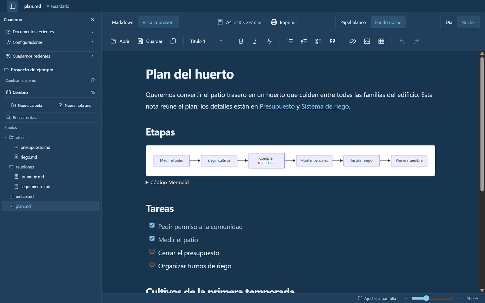
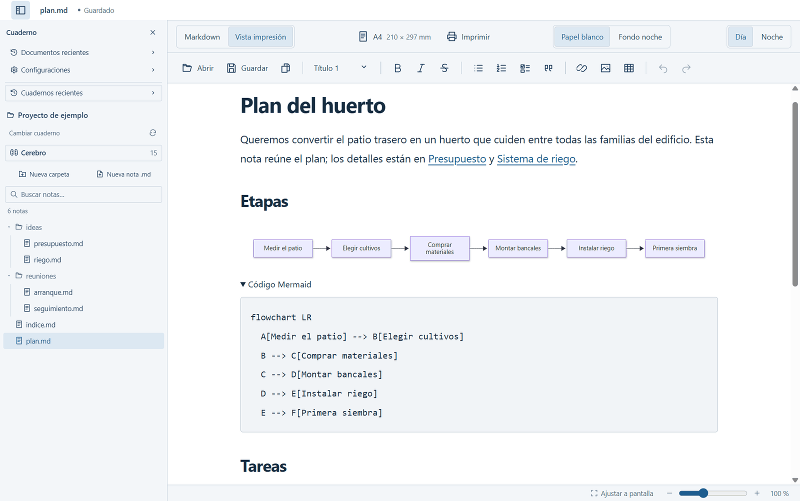

# hiloo

Español · [English](README.en.md)

Editor de notas Markdown para Windows. Escribes con formato, como en un procesador de textos, y hiloo guarda archivos `.md` normales en tu disco.

- **Archivos locales.** Son archivos `.md` en una carpeta de tu PC. No necesitas cuenta, y puedes abrirlos con cualquier otro editor. La conexión con la nube es opcional y experimental.
- **Cuadernos y conexiones.** Una carpeta es un cuaderno. Enlaza notas entre sí y mira esas conexiones en un grafo.
- **Preparado para IA.** Una IA externa, como Claude, Cursor o Codex, puede buscar y leer tus notas mediante un servidor MCP, una CLI local y la skill `hiloo-notes`.


> hiloo está en desarrollo. Por ahora funciona solo en Windows de 64 bits y se prueba desde el código fuente: no hay instalador publicado. El guardado es manual; todavía no hay autoguardado ni historial de versiones.

## Qué puedes hacer

### Cuadernos

Abre una carpeta como cuaderno. La barra lateral muestra sus notas y subcarpetas, permite crear notas y carpetas y filtra por nombre. hiloo recuerda tus últimos diez cuadernos y documentos.

El botón **Enlace** busca una nota del cuaderno y escribe el enlace Markdown por ti. Para abrir la nota enlazada, usa la barra lateral o Cerebro; al pulsar un enlace dentro de la nota, hiloo te deja editarlo.

Al abrir un cuaderno sin índice, hiloo ofrece crear `indice.md` con un mapa de sus notas, pensado para ti, para tu IA o para ambos.

### Dos vistas: con formato y en código

**Vista impresión** muestra la nota con formato y la editas directamente: títulos, listas, tareas, tablas, citas, imágenes y enlaces. **Markdown** muestra y edita el código fuente. Puedes cambiar de vista en cualquier momento sin tocar el archivo.

| Vista impresión | Markdown |
| --- | --- |
|  |  |

### Temas Día y Noche

La interfaz tiene tema Día y tema Noche. La hoja se elige aparte: papel blanco o fondo noche, como en esta captura. La barra inferior controla el zoom.



### Diagramas Mermaid

Escribe un bloque de código `mermaid` y hiloo dibuja el diagrama dentro de la nota. Por ahora admite diagramas de flujo (`flowchart` y `graph`). El código sigue editable debajo.



### Cerebro

**Cerebro** dibuja el cuaderno como un grafo: cada nota es un punto y cada enlace, una flecha. Pulsa una nota para leerla sin cerrar la que estás editando.


### Imprimir

**Imprimir** abre una vista previa con las páginas reales. Ahí revisas el resultado y después eliges la impresora en Windows. Puedes elegir el papel (Carta, Oficio, Legal, A4, A5 o uno a medida) y ajustar el estilo impreso con tu propio CSS.


## hiloo + IA

hiloo no lleva una IA dentro. Cuando abres un cuaderno, hiloo lo añade a un índice local en SQLite (`%APPDATA%\hiloo\brain.sqlite`) con búsqueda de texto completo. Nada sale de tu PC.

Claude Desktop, Claude Code, Cursor y otros clientes MCP consultan ese índice con el servidor MCP de solo lectura que incluye hiloo: catálogo, búsqueda, secciones, lectura y enlaces. Configuración copiable para la app instalada y para desarrollo: [Servidor MCP](docs/mcp.md).

Una IA que ejecuta comandos también puede usar la CLI `scripts/brain.cjs`, que además registra cuadernos y crea enlaces manuales. La CLI necesita `npm ci` y `npm run build` una vez:

```powershell
node scripts/brain.cjs catalog                 # cuadernos registrados
node scripts/brain.cjs search "riego goteo"    # buscar en las notas
node scripts/brain.cjs read <chunk-id>         # leer un fragmento; el id sale de search
```

Las respuestas son JSON con límites de tamaño, para que la IA lea solo lo necesario. El índice solo ve notas guardadas.

La skill [`hiloo-notes`](skills/hiloo-notes/SKILL.md) enseña a la IA a usar el MCP o la CLI: empezar por el catálogo, buscar y leer fragmentos. Para guardar notas, la IA usa sus propias herramientas de archivos con las reglas de la skill, que evitan pisar cambios ajenos. Copia la carpeta `skills/hiloo-notes` donde tu herramienta busque skills y define la variable de entorno `HILOO_ROOT` con la ruta de este repositorio.

Comandos, límites y funcionamiento del índice: [Índice para IA](docs/cerebro-sqlite.md).

## Nube (experimental)

hiloo empieza a conectarse con una nube compartida por organizaciones. Por ahora solo inicia sesión y hace una lectura de prueba; todavía no sincroniza notas.

- **Inicio de sesión con Auth0.** **Cuenta en la nube** abre el navegador para entrar con Auth0. hiloo usa el flujo para apps de escritorio (código de autorización con PKCE) y guarda la sesión cifrada con la protección de datos de Windows.
- **Supabase con RLS por organización.** Supabase acepta el token de Auth0 y sus reglas de seguridad por fila (RLS) dejan leer solo los datos de las organizaciones de cada persona.
- **Estado.** La prueba 0c está verificada con un inicio de sesión real: un usuario lee las filas de su organización y no las de otra. Es experimental y puede cambiar.

Para activarla al compilar, crea un archivo `.env` en la raíz del repositorio con estas variables (no se suben a git):

| Variable | Para qué |
| --- | --- |
| `SUPABASE_URL` | URL del proyecto de Supabase. |
| `SUPABASE_PUBLISHABLE_KEY` | Clave publicable de Supabase. |
| `SUPABASE_JWKS_URL` | Claves públicas del proyecto; la app no la necesita. |
| `AUTH0_DOMAIN` | Dominio del tenant de Auth0. |
| `AUTH0_CLIENT_ID` | Client ID de la aplicación nativa de Auth0. |

`SUPABASE_SECRET_KEY` puede estar en el mismo `.env` para herramientas de administración, pero **la app no la usa** y nunca entra al paquete. Sin el `.env`, hiloo funciona igual y el diálogo indica que la nube no está configurada. Detalles, configuración de Auth0 y pruebas: [Nube con Auth0](docs/nube-auth0.md).

## Probarlo

Necesitas Windows de 64 bits, Node.js 22.13+ o 24+ y npm. Desde la carpeta del repositorio:

```powershell
npm ci        # instala dependencias y Electron
npm run dev   # abre hiloo en modo desarrollo
```

Con pnpm funciona igual: `pnpm install` y `pnpm dev`. El lockfile del repositorio es `package-lock.json`. Si instalaste antes de este cambio y `dev` dice `Electron uninstall`, descarga Electron con `node node_modules/electron/install.js`.

Para empezar con notas de ejemplo, pulsa **Abrir cuaderno**, elige [`docs/demo/Proyecto de ejemplo`](docs/demo/Proyecto%20de%20ejemplo) y abre `plan.md`. Después pulsa **Cerebro**. Es el mismo cuaderno de las capturas.

Otros comandos:

| Comando | Qué hace |
| --- | --- |
| `npm run build` | Comprueba tipos y compila en `out/`. |
| `npm start` | Abre la versión compilada. |
| `npm run pack:win` | Crea `dist/win-unpacked/hiloo.exe`. |
| `npm run dist:win` | Crea un instalador NSIS sin firmar, para uso propio. |
| `npm test -- --project=local` | Ejecuta las pruebas de Playwright tras `npm run build`. |

## Próximamente

Hay trabajo en marcha, sin fecha, en enlaces que se abren al pulsarlos, pestañas, mejor búsqueda en varios idiomas, herramientas MCP para escribir notas y actualizaciones automáticas.

## Documentación

- [Cuadernos y Cerebro](docs/cuadernos-y-cerebro.md)
- [Vistas, zoom e impresión](docs/vistas-e-impresion.md)
- [Markdown admitido y Mermaid](docs/estilo-markdown.md)
- [Tema de la interfaz](docs/tema-interfaz.md)
- [Índice para IA](docs/cerebro-sqlite.md)
- [Servidor MCP](docs/mcp.md)
- [Nube con Auth0 (experimental)](docs/nube-auth0.md)
- [Guía de desarrollo](docs/desarrollo.md)
- [Alcance implementado y pendiente](STACK.md)

## Contribuir

Lee [CONTRIBUTING.md](CONTRIBUTING.md). Para errores y propuestas, abre un [issue](https://github.com/dropdream/hiloo/issues/new/choose).

## Licencia

[MIT](LICENSE).
